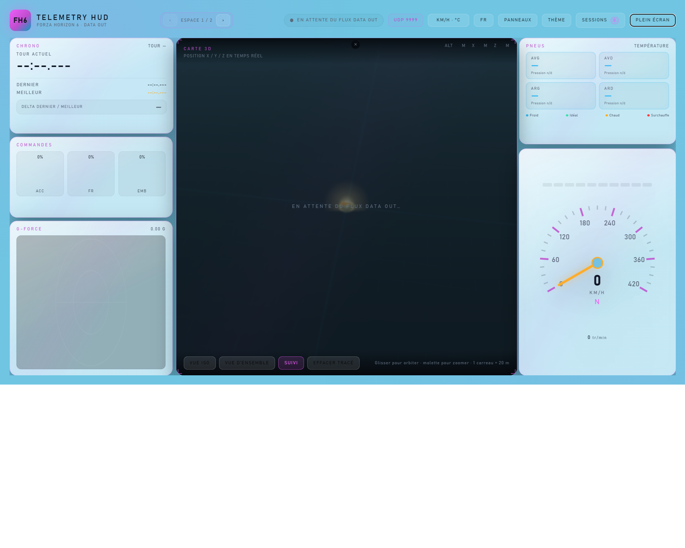

# HUD_FH6 — HUD de télémétrie pour Forza Horizon 6

Dashboard de télémétrie en temps réel pour **Forza Horizon 6**, alimenté par le flux
officiel **Data Out** (UDP). Le HUD tourne dans un navigateur, **sur le PC de jeu ou sur
un second PC du réseau local** : le jeu envoie ses paquets au serveur, qui les décode et
les pousse au dashboard via SSE.

Aucun accès mémoire au jeu, aucune modification de ses fichiers : la seule source de
données est le flux UDP officiel.



## Fonctionnalités

- Vitesse en KM/H et MPH, rapport, compte-tours en arc avec shift light
- Pédales accélérateur / frein / embrayage
- Températures des 4 pneus avec code couleur thermique
- G-force avec traînée historique
- Chrono tour actuel / dernier / meilleur + delta dernier vs meilleur
- Mini-carte 3D Three.js : tracé de la position X/Y/Z en temps réel, altitude,
  caméra orbitale, suivi de la voiture et vue d'ensemble
- Tracé coloré **par tour** (T1 bleu, T2 vert, etc.) avec une légende cliquable
- **Archivage serveur** des courses : chaque session (même en monde libre) est écrite
  sur disque en paquets bruts, avec ses métadonnées et ses tours
- **Analyse** : rejouer une session, cliquer sur n'importe quel point du tracé pour
  lire la télémétrie de cet instant (tour, rapport, vitesse, températures, G…) et
  faire défiler le temps au curseur
- **Unités internationales** : bascule métrique ↔ impérial (km/h ↔ mph, °C ↔ °F,
  m ↔ ft/mi) via le bouton de la barre supérieure, détection automatique selon la
  langue du navigateur et préférence mémorisée
- **Deux espaces de travail** : les tuiles se répartissent sur deux pages, rejoignables
  par les flèches de la barre supérieure ; une tuile change d'espace en étant déposée
  sur l'une d'elles, et sa position est mémorisée
- **Fenêtres flottantes** : chaque tuile se déplace librement, se redimensionne par ses
  **quatre coins**, se superpose à ses voisines et passe au premier plan au clic ;
  aimantation à **12 px** des bords et des tuiles voisines, taille minimale 150 × 110 px
- **Disposition mémorisée** : position, taille, espace d'appartenance et visibilité de
  chaque tuile sont conservés dans le navigateur et réappliqués au lancement
- **Menu Panneaux** : afficher ou masquer une tuile à la volée, réinitialiser la
  disposition d'usine
- **Thèmes** : trois ambiances (Cyber, Ember, Daylight clair), accent et fond
  personnalisables, compteur **digital ou analogique**, réinitialisation
- **Bilingue FR / EN** : bascule instantanée de toute l'interface, **indépendante** du
  système d'unités (français + mph ou anglais + km/h restent possibles)
- **Archivage pilotable** : interrupteur d'enregistrement dans la fenêtre Sessions et
  épinglage d'une session pour la soustraire à la purge automatique
- **Compteur analogique** gradué jusqu'à **420 km/h** (280 mph) pour les voitures les
  plus rapides, avec vitesse numérique sous le moyeu de l'aiguille
- **Légende des tours** compacte : une seule ligne défilante, limitée aux 10 derniers
  tours au direct (tous les tours restent accessibles en analyse)

> La **pression des pneus n'est pas transmise** par le paquet FH6 : le HUD affiche
> « Pression n/d » plutôt qu'une valeur inventée.

## Architecture

```
PC jeu (Forza Horizon 6)          PC HUD
┌──────────────────────┐         ┌──────────────────────────────────────────┐
│ Data Out UDP 324 o   │────────▶│ serveur Node/TypeScript (port UDP 9999) │
└──────────────────────┘         │   decode → SSE (port HTTP 3000)         │
                                 └──────────────────┬───────────────────────┘
                                                    │ SSE
                                                    ▼
                                 ┌──────────────────────────────────────────┐
                                 │ navigateur : dashboard + carte 3D        │
                                 └──────────────────────────────────────────┘
```

- `src/telemetry/decode.ts` : décodeur du paquet de 324 octets (Little-Endian)
- `src/telemetry/fields.ts` : schéma des colonnes d'analyse exposées au navigateur
- `src/telemetry/udp.ts` : écoute UDP `0.0.0.0:9999`
- `src/telemetry/sessions.ts` : enregistrement disque, segmentation en sessions,
  lecture en colonnes et purge
- `src/server.ts` : HTTP, SSE, service des fichiers publics et de Three.js
- `public/` : dashboard en tuiles autonomes (modules ES natifs, import map Three.js)
- `tools/simulate.ts` : simulateur de flux pour tester sans le jeu

Le format FH6 (324 octets) est identique au format « Dash » v2 de FH4/FH5 ; FH6 ajoute
`CarGroup`, `SmashableVelDiff` et `SmashableMass`. Voir
`Documentation/References.md` pour le détail et les licences des projets d'inspiration.

## Démarrage

Prérequis : Node.js 20 ou plus récent.

```powershell
npm install
npm run dev
```

Ouvrir <http://localhost:3000>. Sans le jeu, lancer le simulateur dans un second
terminal :

```powershell
npm run sim
```

Le simulateur envoie des paquets à `127.0.0.1:9999` à 60 Hz et simule un tour de
circuit avec altitude, rapports, pédales, températures et chronos.

## Version portable (Windows x64)

Pour le PC d'affichage, la [page des releases](https://github.com/Z1t0on/HUD_FH6/releases)
fournit un exécutable autonome : **aucune installation de Node.js n'est nécessaire**.

1. Télécharger `HUD-FH6-<version>-win-x64.zip` et l'extraire **en entier** dans un dossier
   inscriptible (par exemple `C:\HUD_FH6`) : l'archive contient `HUD_FH6.exe`, le dossier
   `vendor\` (Three.js, requis par la carte 3D) et la documentation.
2. Double-cliquer sur `HUD_FH6.exe` : une console affiche l'adresse du dashboard
   (`http://localhost:3000`) et l'IPv4 du PC à saisir dans le jeu.
3. Ouvrir cette adresse dans un navigateur ; configurer Forza comme plus bas.

Les sessions sont archivées dans `data\sessions`, **à côté de l'exécutable** : déplacer
l'`.exe` dans un dossier protégé (Program Files…) empêche l'écriture des archives.

> L'exécutable n'est pas signé numériquement : au premier lancement, SmartScreen peut
> afficher un avertissement. Cliquer sur « Informations complémentaires » puis
> « Exécuter quand même ». Les empreintes SHA-256 sont publiées avec chaque release.

### Construire la distribution

```powershell
npm install
npm run package
```

La commande enchaîne la compilation TypeScript, le bundle esbuild (`build/server.cjs`),
l'**icône du projet** (`assets/HUD.ico`) appliquée au binaire Node de base, la copie
figée de Three.js (`vendor/three/`, livrée à côté de l'exécutable), l'exécutable pkg,
l'archive ZIP et les empreintes. pkg ne sachant pas appliquer d'icône,
`scripts/set-icon.mjs` remplace les ressources PE — **avant** l'empaquetage : pkg
ajoute son payload à la fin du binaire et y inscrit des offsets absolus qu'une
réécriture du PE après coup rendrait invalides. Résultat dans `release_dist/` :

| Fichier                              | Contenu                                    |
| ------------------------------------ | ------------------------------------------ |
| `HUD-FH6-<version>-win-x64/HUD_FH6.exe` | exécutable autonome (Node 22 embarqué)  |
| `HUD-FH6-<version>-win-x64/vendor/`  | Three.js servi au navigateur (carte 3D)    |
| `HUD-FH6-<version>-win-x64.zip`      | l'exécutable + `vendor/` + `LISEZ-MOI.txt` + `README.md` |
| `SHA256SUMS.txt`                     | empreintes des deux fichiers ci-dessus     |

Le dossier `vendor/` doit rester à côté de l'exécutable : déplacer le seul `.exe`
laisse la carte 3D vide (le serveur le signale au démarrage).

## Configuration dans Forza Horizon 6

Le HUD fonctionne aussi bien **sur le PC de jeu** que sur un **second PC** du réseau
local. Dans les deux cas, tout se règle dans **Paramètres > ATH et gameplay > Data Out** :

| Installation du HUD | Adresse IP à saisir dans le jeu |
| ------------------- | ------------------------------- |
| Sur le PC de jeu | `127.0.0.1` (bouclage local) |
| Sur un second PC du réseau | IPv4 du PC HUD, relevée avec `ipconfig` (le serveur l'affiche aussi au démarrage, par exemple `192.168.1.42`) |

- Data Out : **ON**
- Port : **9999** — éviter la plage 5200–5300, réservée par le jeu
- Ouvrir ensuite <http://localhost:3000> sur le PC qui exécute le HUD

Sur un second PC, autoriser le port UDP 9999 dans le pare-feu Windows du PC HUD :

```powershell
New-NetFirewallRule -DisplayName "HUD FH6 Data Out" -Direction Inbound -Protocol UDP -LocalPort 9999 -Action Allow
```

Le flux n'est émis que lorsque le joueur roule : pas de données dans les menus, la
pause ou les replays.

Si le port 9999 est déjà pris, le changer des deux côtés :

```powershell
$env:UDP_PORT = 5607
npm run dev
```

## Commandes

| Commande         | Rôle                                        |
| ---------------- | ------------------------------------------- |
| `npm run dev`    | serveur en mode watch                       |
| `npm run build`  | compilation TypeScript vers `dist/`         |
| `npm start`      | serveur compilé                             |
| `npm test`       | tests du décodeur et des sessions           |
| `npm run sim`    | simulateur de paquets à 60 Hz               |
| `npm run bundle` | bundle CommonJS du serveur (`build/`)       |
| `npm run package`| distribution Windows : exe, ZIP, SHA-256     |

## Interface et disposition

Le dashboard est un **bureau de fenêtres flottantes** : les tuiles ne sont pas figées
dans une grille.

| Action | Effet |
| ------ | ----- |
| Glisser la barre de titre | déplacer la tuile librement (elle peut recouvrir ses voisines) |
| Glisser un **coin** | redimensionner (taille minimale 150 × 110 px, jamais hors de l'espace) |
| Clic sur une tuile | la faire passer au premier plan |
| Flèches `‹` / `›` | changer d'espace de travail (2 espaces) |
| Déposer une tuile sur une flèche | la déplacer vers l'autre espace |
| Croix de la barre de titre | masquer la tuile |
| Menu **Panneaux** | réafficher une tuile, réinitialiser la disposition |
| Bouton **Plein écran** | passer le dashboard en plein écran |

L'aimantation aligne la tuile sur les bords de l'espace et sur les arêtes des voisines
à moins de **12 px**, sans jamais empêcher le recouvrement. Les quatre coins portent
seuls une poignée de redimensionnement.

Tout est mémorisé dans `localStorage` (clé `hud-fh6:layout`) : position et taille en
**fractions** de l'espace de travail (donc indépendantes de la résolution), espace
d'appartenance et visibilité. La disposition est réappliquée au rechargement et
recalculée à chaque redimensionnement de fenêtre. En dessous de 760 px de large, les
tuiles repassent en pile et le déplacement libre est désactivé.

## Carte 3D

| Action              | Effet                                              |
| ------------------- | -------------------------------------------------- |
| Glisser             | orbiter autour de la scène                         |
| Molette             | zoomer                                             |
| **Suivi**           | la caméra suit la voiture                          |
| **Vue iso**         | replace la caméra en vue isométrique derrière elle |
| **Vue d'ensemble**  | cadre tout le tracé (caméra libre)                 |
| **Effacer tracé**   | remet le tracé à zéro                              |
| **Retour au direct**| quitte l'analyse d'une session archivée            |

Le tracé est construit à partir des positions reçues : il ne représente que le trajet
parcouru depuis l'ouverture du dashboard. La ligne verticale et le repère au sol
matérialisent l'altitude de la voiture par rapport au sol.

## Unités

Le bouton de la barre supérieure bascule entre deux systèmes, appliqués à tout le HUD
(instruments, inspecteur, carte, sessions) :

| Élément        | Métrique       | Impérial        |
| -------------- | -------------- | --------------- |
| Vitesse        | km/h (rappel mph) | mph (rappel km/h) |
| Températures   | °C             | °F              |
| Altitude, X/Z  | m              | ft              |
| Distances      | m / km         | ft / mi         |
| Échelle carte  | 1 carreau = 20 m | 1 carreau = 66 ft |

Le système par défaut est déduit de la langue du navigateur (États-Unis, Liberia,
Myanmar → impérial). Le choix manuel est mémorisé dans `localStorage`
(`hud-fh6:units`). Les données archivées restent brutes (m/s, °F, mètres) : seuls
l'affichage et les unités de l'interface changent.

## Langue et thèmes

**Langue** : le bouton `FR` / `EN` de la barre supérieure bascule toute l'interface
(libellés, en-têtes, infobulles, notifications) sans rechargement. La langue de départ
suit celle du navigateur ; le choix est mémorisé (`hud-fh6:lang`). Langue et système
d'unités sont **deux réglages indépendants** : le français peut s'afficher en mph/°F et
l'anglais en km/h/°C.

**Thème** : le menu `Thème` propose trois ambiances — **Cyber** (sombre, cyan),
**Ember** (sombre, ambre) et **Daylight** (clair) — ainsi que la couleur d'accent, la
couleur de fond, le style de compteur (**digital** ou **analogique**) et une
réinitialisation. La scène 3D et le compte-tours suivent le thème en direct. Le réglage
est mémorisé (`hud-fh6:theme`) et les textes secondaires (`--muted`) restent lisibles
dans chaque ambiance.

## Sessions et analyse

Le serveur archive **toutes** les données de roulage, y compris en monde libre : les
paquets bruts de 324 octets sont écrits dans `data/sessions/` (ignoré par Git) avec un
fichier `.json` de métadonnées par session (tours, meilleur tour, distance, voiture…).

- Une session démarre au premier paquet et se ferme après **4 s** sans données, un
  changement d'horodatage du jeu (replay, téléportation) ou un saut de position de plus
  de 800 m.
- Les **40 sessions** non épinglées les plus récentes sont conservées ; les plus
  anciennes sont supprimées automatiquement. Une session **épinglée** (`📌`) échappe à
  la purge.
- Le bouton **Sessions** liste les archives (date, durée, tours, meilleur tour) et
  permet de les analyser, de les épingler ou de les supprimer. Il porte aussi
  l'**interrupteur d'enregistrement** : l'archivage peut être suspendu à chaud sans
  couper le HUD, et le choix est conservé dans `data/settings.json`.
- Une session qui n'a pas réellement roulé (menus, atelier, arrêt) est jetée : seuils
  de **30 m**, **2 s** et **60 paquets** (réglables par variables d'environnement).
- En mode analyse, la carte 3D affiche le tracé complet coloré par tour, la légende
  permet d'isoler un tour, et un **clic sur le tracé** fige les instruments sur
  l'instant correspondant. Le curseur de temps et les flèches du clavier déplacent
  l'échantillon sélectionné.
- La fin d'une course déclenche une notification et incrémente le compteur
  « Sessions » ; le HUD reste en direct (`Retour au direct` pour quitter l'analyse).

### Routes HTTP

| Route                      | Rôle                                                         |
| -------------------------- | ------------------------------------------------------------ |
| `GET /events`              | flux SSE de la télémétrie (60 Hz) et des événements session  |
| `GET /health`              | état du flux (paquets, dernier paquet, sessions)             |
| `GET /sessions`            | liste des sessions archivées + session en cours              |
| `GET /sessions/:id/data`   | session en colonnes (`FH6S` + en-tête JSON + Float32)        |
| `POST /sessions/:id/keep`  | épingle ou désépingle une session (`{ "kept": true }`)       |
| `DELETE /sessions/:id`     | suppression d'une session                                    |
| `POST /recording`          | active/suspend l'archivage (`{ "enabled": false }`)          |

### Variables d'environnement

| Variable                    | Défaut          | Rôle                                   |
| --------------------------- | --------------- | -------------------------------------- |
| `UDP_PORT`                  | `9999`          | port d'écoute Data Out                 |
| `HUD_PORT`                  | `3000`          | port HTTP du dashboard                 |
| `HUD_SESSIONS_DIR`          | `data/sessions` | dossier d'archivage des sessions       |
| `HUD_SESSION_KEEP`          | `40`            | nombre de sessions conservées          |
| `HUD_RECORD`                | `1`             | archivage actif au démarrage (`0` = non) |
| `HUD_SESSION_MIN_DISTANCE`  | `30`            | distance minimale archivée (m)         |
| `HUD_SESSION_MIN_DURATION`  | `2`             | durée minimale archivée (s)            |
| `HUD_SESSION_MIN_PACKETS`   | `60`            | paquets minimaux archivés              |

## Structure

```
HUD_FH6/
├── .opencode/skills/  # Skill fh6-data-out (référence du paquet UDP)
├── Documentation/     # Doc Data Out et notes de recherche
├── data/sessions/     # Archives des courses (ignoré par Git)
├── public/            # Dashboard : coquille HTML + tuiles autonomes
│   ├── index.html     #   barre supérieure, deux espaces, import map Three.js
│   ├── hud.js         #   point d'entrée : SSE, distribution des paquets
│   ├── core/          #   noyau partagé (état, bus, i18n, unités, thème, fenêtres…)
│   ├── tiles/         #   une tuile par fichier (chrono, compteur, carte…)
│   └── styles/        #   une feuille par tuile, ordre de cascade dans l'HTML
├── scripts/           # bundle.mjs, package.mjs (release), set-icon.mjs (icône PE)
├── src/
│   ├── server.ts      # HTTP + SSE + UDP → navigateur
│   └── telemetry/     # Décodeur, écouteur UDP, archives de sessions
├── test/              # Tests du décodeur et des sessions
├── tools/             # Simulateur de flux
├── assets/            # Polices, images, icônes
├── screenshot-demo.png
└── README.md
```

`vendor/three/` (à la racine, en développement) et `release_dist/` sont générés par
`npm run package` et ignorés par Git ; le dossier `vendor/three` **livré dans l'archive**
se trouve à côté de l'exécutable.

## Limites connues

- La pression des pneus n'existe pas dans le paquet FH6.
- Le HTTP n'est pas authentifié : à réserver à un réseau local de confiance.
- Le dashboard doit rester visible pour un rendu fluide ; si la fenêtre est occultée
  par le navigateur, une boucle de secours `setTimeout` prend le relais.

## Documentation

- `Documentation/Créer un HUD pour FH6.md` : documentation officielle Data Out
- `Documentation/References.md` : dépôts d'inspiration, licences et compatibilité FH6
- `AGENTS.md` : cadrage du projet et conventions de travail
